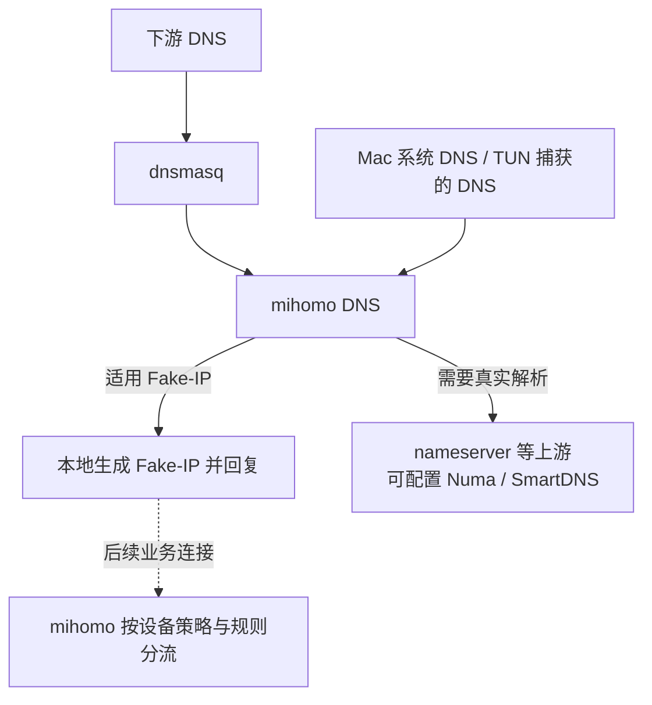
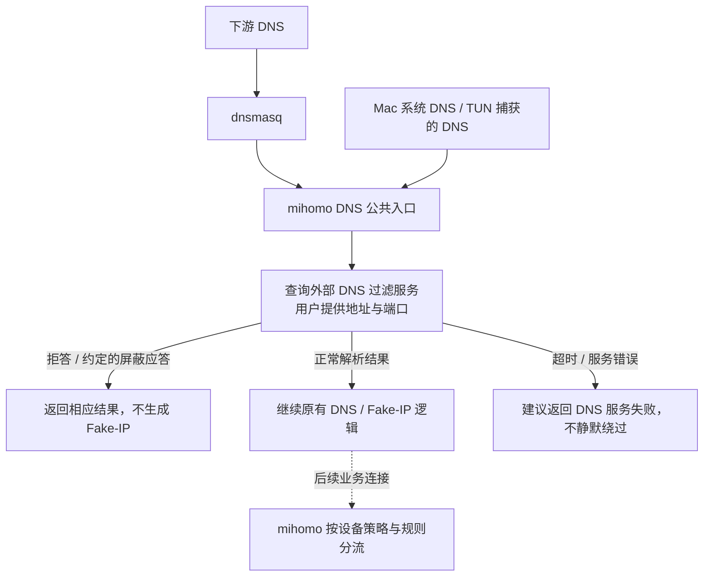

# 外部 DNS 过滤：在 Fake-IP 应答前检查

记录日期：2026-10-21。状态：设计草案，尚未实现或验收。

目标：支持用户自行部署的 Numa、SmartDNS 等 DNS 过滤服务，通过地址和端口接入；
在受管 DNS 查询生成 Fake-IP 前执行过滤，保留 OpenSurge 的设备策略与代理分流。

## 现有流程

`nameserver` 是按需使用的解析后端。Fake-IP 可以直接生成，后续代理又可能使用远端解析，
因此把上游改成 Numa / SmartDNS，并不保证它检查每个业务域名。

## 拟议流程

在 mihomo 的公共 DNS 处理路径加入可选检查，覆盖下游入口与 Mac/TUN DNS 入口。
外部服务继续使用自己的上游，不需要反向转发给 OpenSurge。

正常应答只用于本次检查；应使用 Fake-IP 的查询仍由 mihomo 生成应答，
外部服务返回的真实 IP 不直接替代 Fake-IP。

## 直观对比

| 项目 | 现有流程 | 拟议流程 |
| --- | --- | --- |
| 外部 DNS 的位置 | 需要真实解析时使用的上游 | 生成 Fake-IP 前的检查环节 |
| Fake-IP 查询 | 可以不查询外部 DNS | 受管查询先检查，再按原配置应答 |
| 代理分流 | mihomo 执行 | 继续由 mihomo 执行 |
| 外部服务部署 | 用户自行部署 | 用户自行部署，OpenSurge 只负责接入 |
| 外部服务是否缓存 Fake-IP | 普通上游接法不会收到 Fake-IP | 检查接法同样不向其传递 Fake-IP |

## 保留的边界

- 普通 DNS 应答没有专用的“广告”标记；拒答、空应答、屏蔽地址和服务错误的解释待验证。
- 检查会增加外部 DNS 依赖与查询开销；本地域名、固定映射、内部解析、缓存和递归保护的边界待设计。
- 目标范围是受管 DNS 入口，不承诺覆盖自带 DoH、直接使用 IP、已有连接或未发起 DNS 的显式代理请求。
- 仅记录方向；后续实现须按 DNS、TUN、本机及相关 IPv6 路径分别验收。

现有契约：[系统 DNS 与 TUN](../sources/decisions/local-system-dns-coordination.md)、
[DNS 配置合成](../sources/decisions/mihomo-profile-overlay.md)、
[验证门槛](../sources/validation/test-gates.md)。
