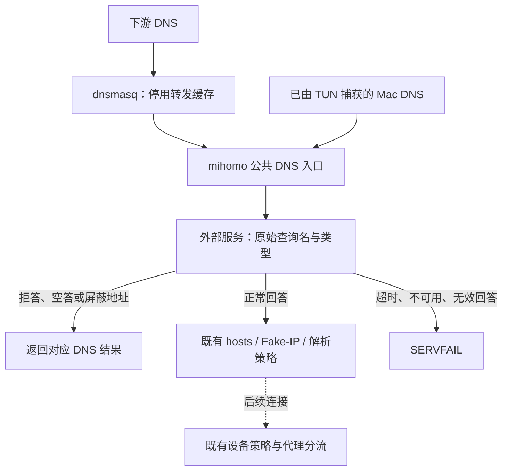

# 外部 DNS 过滤：在 Fake-IP 应答前检查

记录日期：2026-10-21。状态：已进入实现；主机网络验收按用户要求暂缓。
关联：[Issue #102](https://github.com/YTwsy/OpenSurge-for-Mac/issues/102)、
[PR #103](https://github.com/YTwsy/OpenSurge-for-Mac/pull/103)。

目标是接入用户自行部署的 DNS 过滤服务，在受管查询生成 Fake-IP 前检查，同时保留
OpenSurge 的设备策略与代理分流。普通 `nameserver` 只在需要真实解析时使用，无法保证
Fake-IP 查询经过过滤；本次实现因此位于公共 DNS 服务入口。

## 已实现路径

- 网络设置新增默认关闭的外部过滤配置，支持 IP:端口、超时、额外屏蔽 IP 和旁路域后缀；
  配置保存、旧客户端兼容、applied 状态和引擎恢复沿现有控制面规则处理。
- 补丁核心先执行检查，再进入 hosts、Fake-IP 与解析缓存；并发同名检查合并，但不缓存
  允许/拒绝决定。UDP 截断回退 TCP，超时与反向递归有界，失败不自动放行。
- 订阅不能注入过滤字段；不支持该功能的旧核心会因能力参数而显式失败。准备态保留
  配置，但私有 DNS 仍只按自身引用依赖开启；就绪探针只旁路精确 TXT 名称。
- dnsmasq 保留 DHCP 名称，关闭转发缓存与系统 hosts 快捷应答。本地域、反向查询、
  系统私有搜索域、DHCP / MagicDNS 域和明确旁路域沿原路径处理。
- 新增受控 DNS fixture、隔离真实核心检查与可选 Lab 断言。长期配置和行为规范已迁移至
  [过滤契约](../sources/decisions/mihomo-profile-overlay.md#external-dns-filtering-before-fake-ip)，
  可复跑命令见 [测试门槛](../sources/validation/test-gates.md#外部-dns-过滤)。

## 2026-10-21 实现与验证

被测工作树：`codex/docs-external-dns-filter`，基于 `e5cda70` 的本次实现；记录随实现提交。
环境：macOS 14.8.5（23J423）、Go 1.25.3 darwin/arm64。真实核心为从固定上游源码与当前
补丁构建的 `1.19.30-opensurge.1` arm64；测试只监听随机 loopback 地址，使用临时缓存和
受控 DNS/HTTP 服务，不接管主机接口、路由、系统 DNS 或安装态网关。

已完成的验证：

- `make test`：全部 Go 包通过。
- `make web-test`：39 个文件、351 项通过；`make web-build` 通过并更新内嵌资源，
  i18n 检查覆盖 1906 条英文消息。
- 核心构建内的 DNS 过滤与 IPv6 无原生上游配置测试通过；核心 DNS 过滤 `-race` 通过。
  覆盖 A/AAAA、CNAME sink、NODATA/错误、TCP fallback、请求元数据隔离、旁路与递归保护。
- 隔离 `TestExternalDNSFilterRealCore` 通过：UDP/TCP、Fake-IP、hosts、real-IP 例外、
  同名策略改变、断服失败、禁用恢复与停止释放。相关配置、控制 API 和应用状态竞态回归通过。
- 设置当前补丁核心后，`go test ./internal/mihomo ./internal/controlapi -count=1` 全部通过，
  包含准备态、自身 DNS 引用矩阵、绑定竞争与既有控制面回归。未开启正式 1053 分支。
- `python3 tests/packaging/test_mihomo_cache.py`：15 项通过。新增补丁、DNS overlay、
  构建脚本均参与输入失效检查；假构建工具已同步校验新增文件。
- 三个 Lab 脚本的 `bash -n` 与 `git diff --check` 通过。

复验期间，旧 DNS 引用测试夹具遇到一次 TCP 临时端口对应的 UDP 端口已被占用；已为
新旧受控 DNS 夹具加入最多八次分配重试，不停止或替换任何既有 socket 所有者。

未运行、不得据此宣称通过：

- 用户明确选择“暂不运行主机网络验收”。本轮未启动 Lab 虚拟机或执行 DHCP、PF/NAT、
  TUN、Mac 系统 DNS 与三种下游 IPv6 的实际主机网络门槛，也未替换安装态服务。
- 已提供 `make lab-test-external-dns-filter` 入口，但脚本存在和语法通过不代表网络通过。
  恢复验收时还须核对每轮 artifacts 与最终 `lab-down` / `lab-status` 清理。
- 未验证 Numa / SmartDNS 的具体版本、真实部署和屏蔽规则；本轮只证明受控普通 DNS
  应答契约。尚无吞吐量、延迟基线或长期运行数据。
- 客户端缓存、独立 DoH、直接 IP、既有连接以及不发起受管 DNS 的代理请求不在保证范围。

当前证据摘要见 [evidence map](../sources/validation/evidence-map.md#外部-dns-过滤)。
