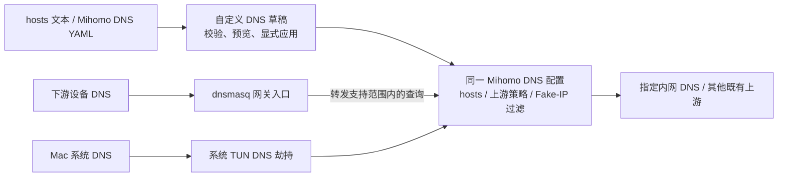

# 订阅自身 DNS 兼容与文件式自定义 DNS

配套说明：[DNS 流程与 YAML 示例](issue-93-dns-references-and-issue-82-overrides/dns-flow-examples.md)，包含监听启动、自身引用、hosts 别名解析及独立本地 DNS 的对照。

- 状态：已完成并归档（2026-10-21）。用户确认以已完成的端到端测试收尾，不再追加 Virtual Lab；实现、双入口实机验收及 build41 安装态预览复验见文末记录。各轮原始未覆盖项保留为证据范围，不再充当本任务待办。
- 创建日期：2026-10-16；兼容开发与方案修订：2026-10-17。
- 目标分支：`codex/release-v0.3.2`；任务创建基线：`538fed9`。
- 需求：[Issue #93](https://github.com/YTwsy/OpenSurge-for-Mac/issues/93)、[Issue #82](https://github.com/YTwsy/OpenSurge-for-Mac/issues/82)，以及本次关于默认兼容、可选高级配置的讨论。
- 本轮范围：用户在方案修订后授权开始实现，并接手后续验收。本轮落地导入、界面、覆盖、候选接入及主要文档，执行软件回归；不运行新增真实核心查询或 host-network Lab。
- 既有工作：此前授权的 DNS-02、DNS-03 及所需 DNS-01 契约保留，实际检查与未覆盖项仍以文末原记录为准。

## 任务创建时的基线与目标

`hosts` 保留已由 `1e5386f` 实现，并通过 [PR #95](https://github.com/YTwsy/OpenSurge-for-Mac/pull/95) 合入当前基线。
它覆盖导入、全局附加配置合成、最终网关配置和准备态配置。此处只记录已合入的代码范围，不代替该 PR 的验证记录。
任务创建时，正式 DNS 监听由 OpenSurge 管理，准备态关闭 DNS 监听，订阅中的解析器地址保持原样。
此前代码补上受支持引用的正式绑定与准备态按需监听；实际验证范围见文末，尚未取得正式网关网络验收。

默认订阅兼容与可选自定义配置分开处理：

| 能力 | 默认行为 | 与高级开关的关系 |
| --- | --- | --- |
| 保留订阅 hosts、DNS 策略及过滤语义 | 默认完成，已有 hosts 修复作为基线 | 始终独立生效 |
| 识别并兼容订阅对自身 DNS 的明确引用 | 已实现默认兼容，正式网关验收待补 | 不要求开启任何高级配置 |
| 文件式自定义 DNS | 已实现；默认关闭、入口默认折叠，真实双入口验收待补 | 独立启用后参与合成 |
| 最终配置依赖、冲突和就绪检查 | 始终执行 | 不因高级配置关闭而跳过 |

首版交付 NAS 等服务的固定地址、公司域名指定内网 DNS、指定域名返回真实地址；
使用 Mihomo 已有的 `hosts`、`nameserver-policy` 和 Fake-IP 过滤能力。
原生 YAML 还可表达多地址、通配和域名别名，按实际核心语义校验。
这些自定义规则统一在 Mihomo 执行，覆盖进入 OpenSurge 的 Mac TUN DNS 与下游 DNS。

界面只提供一个“自定义 DNS”入口、一份草稿和一个独立启用开关，复用现有合成与应用事务。
不新增通用 DNS 规则语言、逐条规则表单、DNS 进程、跨引擎规则翻译或多文件优先级管理。
本次不交付 dnsmasq 原生片段、完整本地域管理、DHCP 动态名称同步、任意 PTR/TXT/SRV 记录编辑、
DNS 脚本、远程文件订阅/自动更新或 Surge 配置转换；这些不作为本次完成条件。

普通订阅自身 DNS 兼容继续独立于自定义 DNS 开关。缺少新草稿等价于未启用，旧配置仍能使用。

相关历史调查位于本地 `codex/tasks-smart-dns-issue-82@3526278` 的
`docs/agent-wiki/tasks/issue-82-dns-policy-smartdns.md`，按需用 `git show` 定向读取。
该调查包含本地域和 SmartDNS 等独立议题；本任务采用现有 Mihomo + dnsmasq，不迁入新 DNS 进程或性能优化任务。

## 设计边界

### 统一执行位置与两个查询入口



dnsmasq 继续提供 DHCP 与网关 DNS 入口；不为这些自定义规则生成第二份 hosts 或 `server=` 配置。
保证同一有效配置下的规则、固定映射与上游选择一致；上游动态答案、缓存 TTL、事务 ID 或地址排序不要求逐字节相同。
绕过 OpenSurge 的应用自带 DoH、mDNS、独立 VPN DNS、未接管设备不在覆盖承诺内。

### 一个合成入口，分别保存解析意图与运行端点

```text
原始订阅及来源信息
  → 保留 hosts、DNS 字段和原监听元数据
  → 合成现有全局附加配置
  → 若开启，合成文件式自定义 DNS
  → 补充受管系统 DNS 协同与运行字段
  → 校验最终规则、用途和服务依赖
  → 按正式网关 / 准备态绑定内部 DNS 端点
  → 生成配置、引擎校验、沿现有事务应用
```

复用现有 YAML 合成及来源信息；保存字段来源、覆盖关系、普通/节点解析用途与服务引用，
不为文件导入另建一套抽象规则执行器。
原监听信息在字段过滤前捕获，并贯穿草稿、重复合成、Helper 交接与重启恢复；只存在于当前函数中的变量不足以保证后续重建。
原始订阅快照保持不变，端口转换发生在最终运行配置。临时端口不写入长期 desired 配置。
可使用小范围结构化模型实现，不要求引入通用规则框架或修改 Mihomo 内核。

### 自身引用的识别范围

以原 DNS 已启用、原监听地址覆盖查询目标、端口和传输协议匹配为基础，定义可自动兼容的明确模式。
首批覆盖 Issue #93 的 IPv4 wildcard listener + loopback 节点解析，以及经验证的 TCP/IPv6 等价形式。
保持真正独立的本地 DNS 和外部 DNS 地址不变；不以当前端口占用者决定配置含义。
不能通过配置确定用途的目标保留来源并报出具体歧义，提供“自身服务 / 独立服务”的显式声明，声明绑定到对应来源和引用。
声明的持久化方式在 DNS-01 冻结，不能借用自定义解析 enabled 开关。

逐个字段定义支持范围：节点解析、普通 nameserver、bootstrap、fallback、direct 及各 policy 的依赖并不等价。
带代理/接口参数、别名或复杂 URL 的解析器按已验证语义处理；未知组合不得简单字符串替换。
全局附加配置或自定义解析改变查询目标后，以最终目标重新分类，不沿用过期的自身引用标记。
检查明显的解析/代理 bootstrap 循环；运行时外部循环不能仅靠静态地址分析保证消除。

### 正式网关与准备态

| 状态 | DNS 服务 | 已确认的自身引用 |
| --- | --- | --- |
| 网关运行 | 保持受管的 1053，dnsmasq 默认上游保持一致 | 绑定到正式 Mihomo DNS 端点 |
| 网关停止，准备态需要自身 DNS | 同一准备态 Mihomo 按需监听可用的本机私有端口 | 绑定到该端点 |
| 网关停止，准备态无此依赖 | 保持不监听 DNS | 无需转换 |

准备态使用与正式配置相同的 hosts、过滤和解析策略；扩展现有仅 controller 的契约时，仅增加必要的 loopback DNS。
DHCP、TUN、pf、转发和系统 DNS 接管继续关闭。端口分配须处理 TCP/UDP 竞争、实际绑定失败及就绪探测，预先探测空闲不代表启动时一定可用。
所有端点纳入现有进程身份与生命周期锁；准备态退出、正式启动交接、失败回滚和跨 boot 恢复均撤销所属资源。
不能凭 controller 可访问推断 DNS 就绪，也不能借另一客户端的 DNS 回答通过检查。

### 文件格式与导入动作

上传是读取文件内容并复制到受控草稿，不保存用户绝对路径、不持续监视原文件。
首版每次处理一个文件，内容上限 2 MiB；服务端与前端都检查大小，服务端负责最终解析与校验。
两种格式均使用 UTF-8，允许 BOM、LF/CRLF、空行和注释。错误定位到行号或 YAML 字段，整次导入失败时保留原草稿。

| 入口 | 格式 | 导入后的动作 |
| --- | --- | --- |
| 导入 hosts 文件 | 文件名 `hosts` 或 `.hosts` / `.txt`；按 hosts 文本解析 | 将本文件转换成完整 `hosts` 映射，替换草稿的 `hosts` 节，保留草稿 `dns` |
| 导入 DNS YAML | `.yaml` / `.yml`；单个 YAML mapping，顶层只能有 `hosts`、`dns`，至少出现一项 | 替换文件中明确提供的草稿节；未提供的节保留 |
| 手工编辑 | 与 DNS YAML 相同的内容 | 编辑同一份草稿，不另存第三种规则模型 |
| 导出草稿 | 规范化的 `hosts` / `dns` YAML | 导出当前自定义内容，不混入订阅、受管字段、运行端口、启用状态或 revision |

文件扩展名只辅助选择入口，内容必须通过对应格式校验。导入先展示“将替换哪个草稿节”和差异，
用户接受后进入未保存编辑状态；不直接保存、开启功能或触发网络应用。
这是“文件导入到草稿”的替换规则，区别于后文“草稿叠加到订阅”的合成规则。

**hosts 文本**：每行一个 IPv4/IPv6 字面地址，后接一个或多个空格/Tab 分隔的名称；`#` 后为注释。
多个名称都映射到该地址，不将第二个名称解释为 DNS CNAME。同一名称在多行出现时按文件顺序合并地址并去重。
名称以 ASCII 或 punycode 输入，规范化为小写并去掉末尾的根点；不自动补搜索域。
此格式不接受通配符、域名作为地址、URL 或 `address=` / `server=` 等 dnsmasq 指令。
单标签名可以解析，但能否应用还须通过后文的 DHCP 名称边界检查。

```text
# NAS 的两个名称，以及可选 IPv6 地址
192.168.50.10 nas.home.arpa storage.home.arpa
fd12:3456:789a::10 nas.home.arpa
```

**DNS YAML**：沿用 Mihomo 的键和值，不使用现有全局附加配置的 `dns.merge` / `dns.append` 包装。
拒绝多文档、重复键（含规范化后的重复域名）、未知顶层字段、非标准标签及循环别名。
`hosts` 值可为 IP、IP 数组或单个别名目标；键可使用当前核心支持的域名匹配语法。
精确匹配与通配匹配的优先级沿用 Mihomo，不承诺兼容 Surge 的从上到下匹配。

`dns` 首版复用现有全局附加配置允许的解析器字段集合，并在实现里共用定义：

| 类别 | 允许字段 |
| --- | --- |
| 上游及选择 | `default-nameserver`、`nameserver`、`nameserver-policy`、`fallback`、`fallback-filter` |
| 节点与直连解析 | `proxy-server-nameserver`、`proxy-server-nameserver-policy`、`direct-nameserver`、`direct-nameserver-follow-policy` |
| Hosts 与 Fake-IP | `use-hosts`、`use-system-hosts`、`fake-ip-filter`、`fake-ip-filter-mode` |
| 已有解析选项 | `respect-rules`、`prefer-h3`、`cache-algorithm` |

首版自定义文件的域名匹配范围使用明确域名和 Mihomo 通配语法；rule 过滤列表使用域名规则与终结 `MATCH`。
本文件暂不引入 `rule-set` / `geosite` 引用、Provider、外部文件路径或自动更新，避免为导入入口新增集合生命周期。
原订阅及专家全局附加配置已有的合法集合引用继续保留；内核支持集合不等于首版导入入口同时提供集合管理。
`dns.enable/listen/ipv6/enhanced-mode/fake-ip-range/fake-ip-range6`、TUN、端口、controller、
`profile.store-fake-ip` 等受管字段一律报错，不静默忽略。不接受完整代理配置、Surge 配置、dnsmasq 配置或 shell 脚本。

以下为可导入的首版示例；它在默认 blacklist 基础上追加公司域名的真实地址例外：

```yaml
hosts:
  nas.home.arpa: 192.168.50.10

dns:
  use-hosts: true
  nameserver-policy:
    '+.corp.example':
      - 10.20.0.53
  fake-ip-filter-mode: blacklist
  fake-ip-filter:
    - '+.corp.example'
```

`nameserver-policy` 选择上游，Fake-IP 过滤决定是否给客户端真实地址。
固定 IP 的 hosts 命中由 Mihomo 先于 Fake-IP 应答；别名会继续解析目标名称，真实地址例外必须覆盖实际解析的目标。
这些配置不创建 NAS 地址、不修改 DHCP 预留，也不建立公司 VPN/路由；上游和服务可达性由既有网络/路由配置负责。

### 配置覆盖规则

有效配置按以下顺序合成；缺少订阅时使用现有 managed 基础配置：

```text
基础配置 / 原始订阅
  < 已启用的全局附加配置
  < 已启用的自定义 DNS
  + OpenSurge 受管运行字段与系统 DNS 协同
```

这里的优先级针对同一键的来源覆盖；通配范围、Hosts 与上游选择的执行阶段仍由 Mihomo 决定。
原始订阅快照保持不变。自定义 DNS 与全局附加配置分别启用，任一开关不控制另一个。
既有专家 Overlay YAML 中的 DNS 仍可编辑；新入口显示它作为较低层来源，不复制、迁移或隐藏旧内容。

| 字段 | 合成规则 |
| --- | --- |
| `hosts` | 按规范化后的域名键合并；同键由自定义值整体替换，IP 数组不与订阅数组相加；不同键保留 |
| `nameserver-policy`、`proxy-server-nameserver-policy` | 按匹配键合并；同键的服务器值/数组整体替换，不把新旧上游混合查询 |
| 其他 mapping，如 `fallback-filter` | 按子键递归合并；其中数组整体替换 |
| 普通标量和解析器数组 | 明确提供的字段整体替换；未提供的字段继承，数组不默认追加；显式空数组也须通过字段/引擎校验 |
| `fake-ip-filter` | 采用下表的模式相关规则，不套用普通数组替换 |
| 缺省、空 mapping 与删除 | 未提供字段或 `{}` 不删除基础条目；从草稿删掉覆盖项后恢复继承。不引入 `null` 删除或额外操作语法 |

Fake-IP 合成以“订阅 + 已启用全局附加配置”的最终模式为基础；缺省视为 `blacklist`：

| 自定义输入 | 处理 |
| --- | --- |
| 未提供过滤列表和模式 | 完整继承 |
| 未写模式，或写了与基础相同的模式 | 继承模式；blacklist/whitelist 保留基础列表并追加去重；rule 模式将自定义条目放在基础条目前，保持各自顺序 |
| 显式切换到不同模式 | 必须同时提供完整过滤列表，作为一组替换基础模式和列表；预览列出被替换的基础条目，不自动翻译或反转含义 |
| 只切换模式、未提供列表 | 报错，避免把原列表解释成相反行为 |

`blacklist` 命中返回真实地址，`whitelist` 命中使用 Fake-IP，`rule` 以规则动作为准。
同模式的空列表表示没有新增条目；rule 中的终结 `MATCH` 及其遮蔽的基础条目必须在预览中可见。
切换订阅可能改变基础模式，预览和应用必须重新合成并显示结果；不能复用旧订阅的合成产物。

启用且存在自定义 `hosts` 时，默认生成 `dns.use-hosts: true`，覆盖较低层的 false 并显示来源；
若同一自定义草稿显式写 false，则报冲突，不丢弃映射或宣称它已对 DNS 客户端生效。
一个名称同时命中 hosts 和上游 policy 时，预览说明 hosts 先命中，上游仅在继续解析时使用。
同键覆盖不等于跨模式覆盖：更具体的基础域名条目可能优先于自定义通配条目，预览须保留该事实。

节点解析用途保持现有契约：普通 policy 不改写独立的 `proxy-server-nameserver-policy`。
但 Mihomo 的 hosts 可能参与节点/Provider 解析，不能承诺 Surge 式的节点名称隔离；
预览标出已知节点名称命中，保存/应用及准备态复用既有自身引用、别名与递归依赖检查。
显式设置的 `direct-nameserver` 可能触发连接时重新解析，须展示是否跟随 policy；
公司 DNS 示例验收必须覆盖该组合，不能只凭第一次 DNS 查询成功认定连接路径正确。

### 界面、草稿与应用

入口位于“代理与规则源”的“自定义 DNS”折叠卡片，与“高级：全局附加配置”并列、独立启用。
网络设置只保留状态摘要和跳转；点击后定位并展开编辑区。桌面 App 与浏览器复用同一 React/Control API。
常驻摘要显示启用状态、映射数量、上游策略数量及“未应用修改”；不显示内部端口或要求用户选择执行引擎。

展开后只有一个 YAML 编辑区，配套“导入 hosts”“导入 YAML”“下载示例”“导出草稿”“预览”“保存草稿”。
启用开关是草稿的一部分；关闭时可查看/编辑并保留内容，只有启用内容参与候选配置。
界面提供 NAS/公司 DNS 的小型示例，不增加逐条 DNS 规则编辑器或多文件排序界面。

预览分为“自定义内容变化”和“最终 DNS 配置”，显示订阅、全局附加配置、自定义、受管来源及覆盖结果。
Mac TUN / 下游入口分别显示配置前提是否满足；“配置检查通过”与未来实际查询测试结果严格区分。
有阻断错误时允许保留格式合法的草稿，禁止应用；语法错误只保留在当前编辑区，不覆盖服务端上次有效草稿。

只保存草稿不修改运行中的 applied 状态。通过既有网关候选应用/启动入口显式应用，
页面跳转不能隐式重载正在运行的网关；停机后的准备态可以按现有规则使用已保存草稿。
来源页同时计入 Overlay 和自定义 DNS 的待应用状态，允许重新应用当前来源；确认后运行中重载，
停机时保存到下次启动。没有精确匹配当前版本的来源行时，回到网络设置按既有启停流程应用，
不能因 DNS 编辑自动改选未使用的来源或订阅刷新后的新版本。未保存的 DNS 修改阻止直接应用，
离开页面前提示用户处理；状态刷新保留编辑内容。
禁用也须应用后才影响运行配置，并恢复“订阅 + 已启用全局附加配置 + 受管设置”。
实现不新增独立 DNS 热加载、重启按钮或第二套回滚路径；失败如实显示旧运行/已停止、desired 和 draft 的状态，
不能承诺现有生命周期不提供的“无中断恢复旧运行态”。

服务端保存一份自定义 DNS 草稿及 schema version、enabled、revision/digest 元数据；
文件正文仍为上述 `hosts` / `dns`，元数据不混入可导出的 Mihomo 片段。
复用现有 Store、`If-Match` 并发控制和 Helper 权威候选快照机制，原文件名仅用于展示。
重复保存、预览、停机准备态、启动和切换订阅不得重复叠加；无订阅、全局附加配置关闭也须可用。

### 双入口一致性的必要条件

1. **转发与接管**：启用后的候选必须使用受管 Mihomo 作为 dnsmasq 上游，并启用 TUN、自动路由及现有 Mac 系统 DNS 协同。
   若已有自定义 `dns.upstream` 绕过 Mihomo，或 Mac 接管关闭，可保存草稿但阻止此次启用应用，指出现有设置入口；不悄悄更改这些开关。
   下游范围限定为使用 OpenSurge DNS/受支持接管路径的设备，绕过网关的 DHCP bypass 设备不计入。
2. **系统 hosts**：自定义 DNS 生效期间，dnsmasq 使用受管 `no-hosts`，避免先用 `/etc/hosts` 覆盖 Mihomo 自定义结果。
   系统 hosts 是否参与解析统一由 Mihomo `use-system-hosts` 决定；关闭并应用后恢复既有 dnsmasq 行为。
   不修改用户的 `/etc/hosts`，并用同名不同 IP 的夹具验证优先级。
3. **DHCP 名称边界**：保留现有租约名称和设备识别，不通过全局 `dhcp-ignore-names` 简化实现。
   DHCP 开启时，单标签名称及配置的 DHCP 域归 dnsmasq 租约解析所有，首版不接受自定义规则覆盖这些名称。
   自定义域名键、通配及别名解析链若与该范围相交，或不能证明不相交，应用前报错；
   检查整个可产生租约名称的范围，不只检查当时已有租约。DHCP 域/开关变化也必须重新校验。
   默认 DHCP 域为 `lan`，上述 `nas.home.arpa` / `corp.example` 示例不占用该域；用户改为其他域时重新判定。
   修改全局上游不转移这些租约名称的归属，也不意味着它们已获得 Mac/下游一致的动态名称解析。
   已有订阅/旧功能不因新增入口关闭而受此新限制；受管协调本身仍按既有规则处理。
4. **系统 DNS 协同**：保留原解析器快照、私有域补充与恢复顺序；补充 policy 不覆盖已经明确给出的同名 policy。
   受管真实地址保护与自定义 rule 的先后关系必须进入最终预览；开启协同时继续拒绝 `system` 回指和已知递归环。
5. **缓存及切换**：本功能的配置或开关变更沿完整候选应用处理，不能只重载 Mihomo 而保留 dnsmasq 的旧答案。
   通过重启所属 dnsmasq 或经过验证的缓存清理使新配置生效；不清除用户无关缓存。
   客户端缓存依 TTL 自行到期，不将其旧结果误判为合成失败，也不因此省略无缓存验收。

以上是首版可接受配置的边界，不能用“两个入口最终都会转发”代替实现。
如果捆绑 dnsmasq/核心的真实行为不符合这些前提，必须先修订方案并说明影响，不能带着已知入口差异交付。

## 既有默认兼容工作

以下保留 DNS-01 至 DNS-03 的已知进展与未完成验收；它们不依赖新的可选入口。

### DNS-01：冻结合成与兼容契约

- [x] 定义原监听来源、自身/独立服务引用、用途声明和最终有效配置的数据流及持久化边界。
- [x] 按本文已确定的方案落实自定义 DNS 的归属、覆盖和禁用语义，代码及主要 source 已同步。
- [x] 列出各 DNS 字段支持的引用形式、准备态资源规则及不能自动判定的情况。

完成条件：为每种输入给出确定的生成结果或具体诊断；高级功能关闭仍可自动兼容明确的自身引用。
在实现时同步主要 source，不提前把任务提案写成当前产品行为。

### DNS-02：订阅引用识别与正式端点绑定

- [x] 在丢弃原监听字段之前捕获来源信息，并通过所有合成、保存和 Helper 路径传递。
- [x] 实现按最终 DNS 配置识别和绑定，保持幂等、原始快照不变、外部和独立本地解析器不变。
- [x] 预览列出原目标、转换后目标、规则来源及冲突；明显循环和不支持组合在应用前报错。
- [x] 从旧安装保存的原始快照重建；缺失原信息时明确诊断，不能猜测或要求启用高级自定义解析。

完成条件：无高级配置的 Issue #93 夹具在正式核心中独立解析、连接；全局附加配置开启与关闭均通过。

### DNS-03：准备态私有 DNS 与生命周期

- [x] 按需分配并绑定 loopback DNS，绑定失败有界处理，核验 UDP/TCP 实际服务。
- [x] 纳入准备态 state、复用、停止、正式网关交接、崩溃和跨 boot 清理；避免随机端口引起无意义重建。
- [x] 在相同解析策略下验证准备态节点测试和 Provider 所需的解析路径，不用外部客户端或既有缓存掩盖错误。

完成条件：准备态与正式态都能处理支持的自身引用，交接及失败后无遗留监听；无依赖的准备态仍不开 DNS。

## 简化方案的实施顺序与状态

原 DNS-04 的独立规则模型/编辑器与 DNS-05 的本地域扩展不再作为实施阶段；改为以下四步：

1. **格式与合成**：实现两种导入、单份草稿、字段允许集、覆盖规则和来源预览；复用 YAML 合成与 DNS 引用检查。
   固定地址、别名、域名上游和过滤模式的真实核心行为按用户新指示留待统一验收。
2. **草稿与界面**：接入 Store/API、revision、网络页单入口、导入替换预览、导出和显式应用；覆盖双语及桌面/浏览器入口。
3. **双入口接入**：接入候选快照、准备态和正式网关；落实上游/系统 DNS 前提、dnsmasq 系统 hosts 处理、DHCP 范围冲突与缓存切换。
4. **网络验收与文档**：完成下列双入口矩阵及必要回归，再更新主要 source、用户指南与能力证据。

- [x] 格式与合成完成。
- [x] 单入口草稿、预览和既有显式启动/来源应用接入完成。
- [x] Mac TUN 与下游的前提校验、冲突处理及运行接入完成（配置/代码层）。
- [x] 主要 source、中英文用户指南、API 与桌面导出说明同步。
- [ ] 双入口真实 DNS/连接验收及既有兼容的正式网络回归完成（用户接手）。

完成条件：同一份导入内容在两个实际入口得到声明的结果；新增开关关闭后恢复原合成结果，
默认订阅兼容不退化；不得只完成文件导入或 Mihomo 直连查询就标记交付。

## 验收与收口

使用脱敏订阅、全新临时缓存、受控 DNS 和代理节点，保留用户现有缓存和运行网关。
别名夹具应让原域名无法直接成功，只有 hosts 替换和预期上游共同生效才能连通，防止偶然成功。

| 场景 | 必须观察到的结果 |
| --- | --- |
| NAS 固定 A/AAAA | Mac 实际系统/TUN 路径与下游查询网关 DNS 均得到自定义地址；按启用的地址族验证实际服务连接 |
| 公司域名与子域名 | 两个入口均只查询指定受控内网 DNS，返回真实地址；无关公网 DNS 观察不到这些名称 |
| 未匹配域名 | 继续遵守原订阅解析与 Fake-IP 策略；有意切换整个过滤模式时以预览声明的替换结果为准 |
| 系统 hosts 同名不同 IP | dnsmasq 不抢先回答；两个入口均遵守 Mihomo 自定义 hosts 优先级 |
| DHCP 名称/通配/别名冲突 | 首版拒绝不受支持的覆盖；无现有租约但未来可能占用的名称也能拦截；旧租约与设备识别继续可用 |
| blacklist / whitelist / rule | 同模式追加、rule 优先级、显式跨模式替换及缺失列表错误均符合契约；不得把 whitelist 条目当真实地址例外 |
| 导入失败与重复导入 | 格式、重复键、越权字段、超限报错；草稿不被部分替换；重复导入/合成幂等 |
| 多来源覆盖与切换订阅 | 映射/policy 来源可解释；清除自定义项恢复继承；无订阅、overlay 开/关均成立 |
| 已有 direct / 节点解析 | 内网业务连接与受控节点/Provider 均按最终配置工作；不借其他客户端或旧缓存通过 |
| 自定义解析关闭，订阅引用自身 DNS | 默认兼容；无需另一客户端或历史缓存 |
| hosts + alias + filter | 节点获得预期真实地址并连通；普通业务 Fake-IP 保持预期 |
| 独立 loopback / 外部 DNS | 目标和协议参数保持正确；歧义可定位和声明 |
| 重复合成、全局附加配置、切换来源 | 来源关系不丢失、不重复改写；最终目标重新判断 |
| 高级配置启用、禁用、重新启用 | 草稿保留，只有启用内容生效；禁用不关闭兼容功能 |
| 准备态、正式态及交接 | 支持的解析关系均可用，资源仅由当前所有者管理 |
| 端口冲突、DNS 未就绪、部分失败 | 准确错误和可重试恢复；不以进程存活代替成功 |
| 保存、应用、禁用及失败 | 保存不影响运行态；应用后两个入口同步变化；旧 dnsmasq 缓存不继续遮蔽结果；失败状态与实际所有者一致 |

两个入口均覆盖 UDP/TCP；Mac 侧使用系统解析和真实 TUN 捕获，下游侧使用 Lab 客户端查询网关。
直接查询 `127.0.0.1:1053` 只属于核心诊断，不能代替任一入口。
使用随机/未缓存名称、受控 DNS 查询日志和实际连接核对上游来源；AAAA 答案测试与 IPv6 传输/拓扑验收分开记录。

按实际改动执行 [验证门槛](../../sources/validation/test-gates.md)：

- Go 合成、校验、API：`make test`，补真实核心的 DNS 行为集成检查；`mihomo -t` 不证明运行时解析。
- DHCP/DNS、配置生成、进程及恢复：`make lab-test`；TUN 路径：`make lab-test-tun`。
- 导入及受控节点出口：`make lab-test-tun-imported-profile`、`make lab-test-tun-imported-egress`。
- 准备态和候选应用交接：`make lab-test-policy-workspace`。
- Mac 实际系统/TUN DNS：本方案必须运行 `make lab-test-tun-local-routing`，并扩展夹具覆盖上述自定义域名；普通 TUN gate 不替代系统 DNS 验收。
- 下游 IPv6 DNS、listener 或相关路径变化：按受影响拓扑运行对应 IPv6 门槛。
- Web 改动：`make web-test`、`make web-build` 并更新 `internal/webui/dist`；桌面桥接变更按需补桌面门槛。
- Lab 收尾：`make lab-down`、`make lab-status`；记录实际版本、环境、检查结果和未覆盖项。

实现完成后更新 [profile 契约](../../sources/decisions/mihomo-profile-overlay.md)、
[系统 DNS 契约](../../sources/decisions/local-system-dns-coordination.md) 和用户指南；仅在概念关系变化时更新 Concept/索引。
新的能力证据或阻塞按仓库规则维护 evidence-map；本次实际验证范围见文末记录。
已选实施阶段完成并提炼长期规则后归档本任务；完整本地域扩展不作为本轮待完成事项。

## 本轮计划修订记录

2026-10-17：用户选择文件式简化方案，要求同时覆盖 Mac TUN 与下游设备，暂不改代码。
本轮只修改任务计划，保留既有自身 DNS 兼容设计与下面的开发证据；不将方案写成已交付能力。
实现前核对当前文件：`internal/mihomo/profile_overlay.go`（现有 DNS 允许集/合成）、
`internal/mihomo/profile.go`（订阅 hosts）、`internal/mihomo/system_dns.go`（系统 DNS 协同）、
`internal/dhcp/template.go`（dnsmasq 入口/租约）与 `web/src/pages/NetworkPage.tsx`（界面入口）。

本轮设计依据：[Mihomo DNS](https://wiki.metacubex.one/config/dns/)、
[Mihomo hosts](https://wiki.metacubex.one/config/dns/hosts/) 与
[dnsmasq 手册](https://thekelleys.org.uk/dnsmasq/docs/dnsmasq-man.html)。
原 DNS-04/05 编号在以下记录中只表示当时尚未实施的旧方案。


## 本次开发与验证记录

2026-10-17，在 `codex/release-v0.3.2@bc2bd95` 的工作区开发；检查针对未提交改动，
不是该基线提交自身的验收。主机 macOS 14.8.5，真实核心使用
`runtime/release-tools/bin/mihomo`，版本 `1.19.30-opensurge.1 darwin arm64`。

实现范围：

- 导入层捕获原 DNS enable/listen、来源摘要、字段用途和覆盖来源；版本化来源元数据经过
  合成文件、Helper 候选与保存路径，最终运行配置才绑定端点，原始快照不变。
- 支持节点解析及节点解析 policy 中明确的 IPv4/IPv6 UDP/TCP loopback 自身引用；正式
  输出为受管 1053。普通/ bootstrap / fallback / direct 自身依赖，以及尚未验证的
  respect-rules、代理/接口参数组合，在应用前明确报错。详细矩阵和用途声明格式已进入
  [profile 契约](../../sources/decisions/mihomo-profile-overlay.md#dns-reference-composition-and-binding)。
- 正式启动对含自身引用的配置补充 UDP/TCP 监听归属与实际应答检查；运行配置使用稳定的
  `.invalid` TXT 探针，避免重复渲染改变配置摘要。准备态替换为其私有随机探针。
  正式就绪失败沿现有启动清理路径停止新进程，不把 controller 已启动视为 DNS 成功。
- 准备态只在有自身依赖时预留 TCP/UDP 同端口，启动后核对所属进程的两种监听并执行
  随机 `.invalid` TXT 探针。绑定竞争最多三次尝试，前次所有者清理完成后才可再启动；
  已运行准备态探针失败只报错，不隐式重启。临时端口与探针仅存于私有运行状态。
- 旧的合成来源即使 overlay 摘要未变，也从已保存的原始快照或 root base metadata 重建；
  原信息缺失时诊断，新增默认兼容不依赖高级自定义解析开关。
- 来源预览增加 DNS 原目标、绑定结果、来源及覆盖信息，中英文文案与嵌入资源同步。
  未实现 DNS-04 编辑器或 DNS-05 本地域后端。

本次检查：

| 检查 | 结果与范围 |
| --- | --- |
| `make test`，设置真实核心路径 | 通过；包含 Go 全量、已有准备态/Workspace 真实核心检查及新增隔离 DNS 用例 |
| `TestDNSReferencesRealCore` 准备态矩阵 | 10 个组合通过：IPv4/IPv6 引用形式 × UDP/TCP × overlay 开关的 8 例，加上节点解析 policy 的 2 例；每例新临时缓存、受控 DNS/HTTP 节点/Provider；证明 hosts 别名与预期上游共同生效、节点真实地址、业务 Fake-IP、停止后 TCP/UDP 监听释放。各例正式生成配置也通过真实核心 `-t` |
| `TestPreparedDNSBindRaceRealCore` | TCP、UDP 竞争分别通过；首次核心未拥有完整监听时不能靠 controller 通过，停止后换端口成功 |
| `go test -race ./internal/mihomo ./internal/controlapi -count=1`，设置真实核心路径 | 通过；修复旧真实核心测试在 Provider 异步初始化完成前断言成员的时序问题，改为有界等待实际成员 |
| 正式端口真实核心矩阵 | 已尝试，1053 TCP 绑定报告地址占用；保留现有服务，没有启动对应测试核心。此后该分支由 `OMG_DNS_REFERENCE_GATEWAY_CORE=1` 显式选择，当前未通过 |
| `make web-test` | 32 个文件、298 项测试通过，包含中英文 DNS 预览 |
| `make web-build` | 通过 i18n、TypeScript 与生产构建，刷新 `internal/webui/dist` |
| host-network Lab | 未运行；`sudo -n true` 报需密码，`lab-status` 显示两测试 VM 停止、Lab gateway state 为 none。未启动本次 Lab，不把初始状态当作执行后的清理验收 |

仍需补齐：正式 1053 空闲环境中的真实核心矩阵；`make lab-test`、`make lab-test-tun`、
`make lab-test-tun-imported-profile`、`make lab-test-tun-imported-egress`、
`make lab-test-policy-workspace`，以及该轮实际使用的 `lab-down` / `lab-status` 收尾。
本次未改变系统 DNS 接管或下游 IPv6 数据面；IPv6 引用被绑定到本机 IPv4 端点的结果，
不能代替 IPv6 拓扑验收。真实网络完整交接、物理设备和安装包均未在本次验证。
阶段内复选框表示对应实现已落地，不表示上述完整阶段验收条件已经满足；任务继续保留。


## 文件式自定义 DNS 实施记录

2026-10-17，按用户“按更新后的简化方案开始实现，之后的验收我统一做”继续开发。
当前工作区分支 `codex/dns-02-03-references`，基线 `a7a5dd6`；以下结果针对本轮未提交改动，
不表示该基线提交或已安装版本具有这些新增功能。保留上文 DNS-02/03 的历史证据与缺口。

已实现：

- `internal/mihomo/custom_dns.go`：UTF-8/2 MiB 导入、规范化、严格字段检查、按区块替换；
  独立启用、hosts/policy 覆盖与三种 Fake-IP 模式规则；别名冲突、节点/Provider 命中提示、
  direct-nameserver 和覆盖来源预览。输入不引入新 DNS 进程或任意 dnsmasq 配置。
- `internal/controlapi/custom_dns.go`：单份草稿、锁内 If-Match、无写入导入预览、配置预览和
  desired/applied 状态；已保存草稿随 Helper 候选快照传递。准备态/启动/来源切换共享合成顺序，
  运行策略视图不读取草稿。新配置摘要和候选元数据支持重复合成、禁用恢复及重新检查 DHCP 设置。
- `internal/dhcp/template.go`：自定义 DNS 启用候选加入 `no-hosts`，保留 DHCP 名称/设备识别；
  同时检查受管上游、Mac TUN 自动路由、系统 DNS 协同、DHCP 范围及已知转发环。
  启动/来源完整 reload 沿现有生命周期重建 DNS 服务，未增加 DNS 单独热加载入口。
- 网络页增加折叠 YAML 编辑器、导入采用前预览、示例、导出、最终配置和保存草稿；双语及嵌入
  资源同步。桌面导出使用原生保存对话框，浏览器下载文件。
- 主要 profile、系统 DNS、Control API、桌面能力契约、中英文用户指南及 evidence-map 同步。

软件检查：

| 检查 | 结果与范围 |
| --- | --- |
| `make test`，`GOCACHE=/private/tmp/opensurge-custom-dns-gocache` | 通过 Go 全量回归；未启用可选真实核心集成标志。新增测试覆盖导入原子性、规范化、过滤模式、DHCP/别名/转发环、草稿 CAS、预览无副作用、source/overlay 开关组合、启用/禁用恢复及 dnsmasq hosts 所有权 |
| `make web-test` | 33 个文件、304 项通过；包括保存冲突保留编辑、导入采用前预览、UTF-8 错误、阻断提示、原生导出和英文界面 |
| `make web-build` | i18n、TypeScript、生产构建通过；已刷新 `internal/webui/dist` |
| `make desktop-test` | 桌面 internal 包 race 检查通过，覆盖新增导出能力的固定文件名、参数和边界；原生链接仍输出已有工具链 warning |
| 桌面主模块 `go build` | 编译通过；输出为临时检查产物，未制作或安装 App/PKG；工具链输出 macOS 部署目标链接 warning |

测试环境备注：默认沙箱无法写 Go cache，亦限制读取 macOS boot session；改用临时 cache，
全量 Go 回归在允许读取启动标识的执行环境运行。首次全量中旧 dnsmasq 假进程测试未在
两秒内写出参数文件，单独复测及随后全量均通过；未为此改动该测试或网关进程实现。

按用户安排，本轮未做新增真实核心 DNS 查询、`mihomo -t` 专项矩阵、Lab、Mac 系统/TUN
实际捕获、下游实际查询/服务连接、同名系统 hosts 的真实优先级、真实缓存切换或安装包验收。
上文验收矩阵仍作为后续清单；本任务保持未收口，不把配置预览/单元测试写成网络验收通过。

## 自定义 DNS 入口与应用状态调整

2026-10-18，按用户确认调整 React 界面：自定义 DNS 移到“代理与规则源”，与全局附加
配置并列；网络设置仅保留草稿状态、数量、待应用提示与直达链接，跳转会展开并聚焦编辑区。
来源应用状态同时计入 DNS 草稿，包括禁用变更；复用现有来源校验/确认/应用事务，成功后
刷新来源、Overlay 和 DNS 状态。无精确当前来源时回到网络设置启停，不自动改选其他来源。
未保存编辑在状态刷新和失败时保留，离开页面有保护；DNS 读取失败可原地重试，其他来源
内容仍可读取。配置存储、合成规则、API 和网关生命周期保持原有实现。

本轮未提交改动通过 `make web-test`（33 个文件、315 项）、`make web-build`（i18n、
TypeScript、生产构建及嵌入资源刷新）、`make test`（Go 全量，临时 GOCACHE、包并发 2）
和 Control Service 的临时输出编译。新增交互回归覆盖跳转定位、启用/禁用的待应用状态、
运行中重载确认、停机保存、失败保留草稿、未使用/已刷新来源、导航保护和读取失败重试。
中英文使用指南及主要来源同步；本轮未安装、重建 PKG 或执行真实网络验收。

同日继续调整自定义 DNS 的视觉层级。折叠卡片直接复用全局附加配置的背景、图标底座、
标题、状态标签和展开箭头；编辑工具集中到 YAML 工具栏，格式与覆盖说明默认折叠，
保存草稿与应用到网关各自保留清晰的操作区。同步浅色/深色主题、窄卡片布局及英文文案。
隔离的 React 界面预览使用虚拟数据检查上述布局；Web 全量 315 项通过，最后的卡片头
调整后定向 94 项交互回归及 `make web-build` 通过。仅改变呈现，不扩展真实网络验收范围。

## 2026-10-21 安装版实机验收（部分范围）

### Mac 本机 IPv6 核心与构建背景

此前旧缓存核心曾在无原生 IPv6、DNS AAAA 关闭时清除显式 host TUN IPv6 地址，导致
OpenSurge 的 IPv6 就绪检查失败；禁用 TUN 的解析测试未覆盖这一组合。后续构建加入
确定性的无上游核心测试及启用 TUN 配置的隔离二进制测试，并核对核心源码、补丁、构建
参数和二进制摘要，不匹配时重建。这部分证据仅限核心配置解析与打包，不代替以下实机验收。

### 执行环境与结果

用户授权使用当前安装版测试 Mac 本机 IPv6 开关和自定义 DNS，允许必要网关重启并要求恢复
原配置，明确本轮不运行 Virtual Lab。被测版本为 v0.3.2 build39，构建记录来源提交
`4ab752b51a758fdd359e83b991e523c2c7370aa5`；macOS 14.8.5 / arm64，Mihomo
`1.19.30-opensurge.1`，现有 `same_wifi_dhcp` 网关。以下结果属于该安装环境，不是后来源码
或所有平台的验收。没有修改产品代码、重建安装包、提交或发布。

USB 只承载 ADB 控制，Android 的数据走现有 Wi-Fi。手机原有 VPN 会接管默认解析；显式查询
Mac DNS 的结果与默认 VPN 解析分开记录。最终下游系统解析/HTTP/HTTPS 使用临时 Java 探针
对自身 socket/解析单独绑定既有 Wi-Fi 网络，不关闭 VPN、不改手机 DNS/代理设置。最初 `nc`
二进制 DNS 探针的间歇空响应由该探针复核取代，不据此判定 UDP DNS 功能失败。

| 实际检查 | 结果与证据范围 |
| --- | --- |
| 自定义 DNS 预览 | 失败：Control Service 读取 `runtime/policy-workspace/base.json` 时 permission denied；Mac/downstream 前提标志均为 ready。未调整该目录权限 |
| 保存草稿 | 保存后 runtime state、进程与运行配置未变，desired/applied 正确显示待应用 |
| 正式应用及禁用 | 通过原来源 apply 接口，由安装版 Helper 执行最终校验与完整 reload；成功后 desired/applied 一致，禁用并应用恢复原 DNS |
| 固定 A、hosts 别名、指定 DNS 上游与真实地址例外 | Mac 和 Android 显式查询网关，UDP/TCP 均得到预期地址；受控上游记录命中；dnsmasq 启用 `no-hosts` |
| 真实系统解析和服务访问 | Mac 系统解析后 HTTP 成功；Android 绑定 Wi-Fi 后，hosts 与 policy 域名的系统解析/HTTP 均成功，Wi-Fi HTTPS 返回 200；默认 VPN 的 UnknownHost 不归因于网关 DNS |
| 应用与缓存切换 | 先缓存受控上游的 300 秒 TTL 答案；仅改草稿仍返回旧值，应用 hosts 覆盖后四条 UDP/TCP 查询路径均立即得到新值，dnsmasq PID 改变 |
| AAAA 关闭语义 | 普通 policy AAAA 在两端 UDP/TCP 均为空；显式 hosts 中的文档 IPv6 地址在同样条件下仍被返回，与用户指南的统一受开关控制说明不一致 |
| Mac 本机 IPv6 / AAAA 四组合 | 均完整停止、保存两项偏好、启动；开启时实际 TUN 地址和公网/fake IPv6 受管路由存在，关闭时撤销。AAAA 独立控制普通 fake-AAAA；四组合的 Mac IPv4 HTTPS 与 Android Wi-Fi HTTPS 均成功 |
| IPv6 实际请求 | 初次直接域名的强制 IPv6 curl 失败；之后显式使用当前 DNS 返回的 fake-AAAA，普通源和绑定 TUN IPv6 源的 HTTPS 均返回 200，核心日志记录该 TUN IPv6 来源。不将复验通过推导为全部应用解析/缓存兼容 |
| 一次来源 reload 失败与回滚 | 新核心 API 未在现有 2 秒窗口就绪，事务恢复旧配置和运行网关；但 DHCP 接管记录退回 `router_dhcp_disabled_confirmed`。实际运行与记录核对后恢复原接管记录；后续复测成功，原失败保留 |
| 最终恢复 | 系统 config 与原 profile、来源列表、全局附加配置、偏好和接管记录按备份逐字节核对；原先不存在的 DNS 草稿文件恢复为不存在。原配置重新加载，网关/TUN ready，Mac IPv4 与 Android Wi-Fi HTTPS 再次通过。手机临时探针删除，原 VPN/DNS/代理设置保留 |

来源应用会把 profile 引用规范化到新的持久化路径。仅恢复 DNS 开关不足以声称原配置逐字节
一致；本次经 macOS 管理员认证，在生命周期锁内核对唯一差异为该引用且有效 profile 内容
相同后，原子恢复原系统配置，再重载原配置对齐 applied digest。来源列表中测试更新的派生
`effective_digest` 也恢复到原备份。操作历史和运行日志保留本次测试痕迹，不回滚审计记录。

脱敏机器结果保存在本地 `artifacts/installed-acceptance/2026-10-21-v0.3.2-build39-os8ecntjag/acceptance-results.json`；
原始配置、凭据相关材料、ADB 标识、网络地址和日志仅留私有临时证据目录，不写入本文或公开制品。

未覆盖：Virtual Lab、完整 DNS-02/03 自身引用矩阵、准备态到正式态的全量交接、系统 hosts
冲突、whitelist/rule 全矩阵、文件选择/导出等原生 UI、原生 IPv6 出口、下游 IPv6（始终 off）、
夸克登录、所有应用 IPv4 自动回退、睡眠/重启恢复及其他 macOS/架构。上表只补充相应路径证据，
本任务的完整验收项保持未完成。上表保留 build39 的原始观察，后续处理不改写其被测版本。

## 2026-10-21 实机反馈后的处理

用户确认保留显式 hosts 的 AAAA 行为：启用 hosts 后，手工 IPv6 映射优先于 `dns.ipv6`，
普通上游与 Fake-IP 的 AAAA 仍由开关控制。同步修正中英文 App 指南、本机路由说明和领域
契约；这次调整文档语义，不改 Mihomo 或生成配置。返回地址与 IPv6 路径可达性分别验证。

重载的 2 秒 API 就绪超时和旧网关回滚后 DHCP 阶段误报，转入
[独立任务](reload-readiness-and-recovery-state.md)，按用户要求本次不修复。

预览权限修复改为由 Helper 接收控制服务组装的草稿快照，在生命周期锁下读取 root-only
base 并在临时目录合成，只返回 DNS/hosts 区块与诊断，结束后删除候选文件。不放宽 base
权限，不启动准备态或网关进程，不保存草稿或 desired config。配置 revision 不符或 Helper
不可用时明确报错。现有安装版 build39 未替换，仍需新 Control Service 与 Helper 配套安装
后复验预览入口；源码回归不写成安装版已修复，也不扩大原实机或 Lab 证据范围。

本次源码检查（2026-10-21，当前工作区，尚未提交）：

- `GOCACHE=/private/tmp/opensurge-go-cache make test`：正常主机权限下全量通过，包含既有
  来源应用/回滚事务回归；沙箱首轮的 boot-session 读取被拒及进程启动失败由原命令主机
  重跑复核，不修改产品逻辑规避环境限制。
- `go test -race ./internal/controlapi -count=1`：正常主机权限下通过。新增回归覆盖从基线
  反复预览、缺失来源库快照、禁用后恢复继承、过期 revision、取消、生命周期锁竞争、
  合成错误和临时文件清理；草稿、原 profile、desired config 与 base 保持不变。
- `TestCustomDNSPreviewRootHelperPermissions`：编译测试二进制后，以 root 设置
  `OMG_TEST_ROOT_DNS_PREVIEW=1` 执行；managed/imported 两项均通过。实际 UID 65534
  子进程先确认无法读取 root 的 `0700` 目录/`0600` base，再通过组授权 `0660` Unix
  socket 请求真实 Helper 分发与预览，检查无非 DNS 凭据泄露、无配置写入、无权限放宽和
  临时候选残留。仅使用隔离临时目录，不执行引擎、不改变宿主网络或已安装服务。
- `git diff --check`：通过。本次不重建/安装 PKG、不运行 Virtual Lab，不复测实际网关流量。

## 2026-10-21 build41 替换安装与预览复验

文档分层整理先提交为 `2fe32e3797d07384b93e5afd1dac42c137d246cc`，随后从该提交的干净
Git 导出构建 v0.3.2 build41 / arm64（macOS 13.0+），包含 `319034a` 的预览权限修复。
安装包为 `artifacts/gui-installer/OpenSurge-for-Mac-0.3.2-arm64-build41-2fe32e3-unsigned.pkg`，
SHA-256 为 `507f9756508d0f03474dc42aa342f08ec45c1bd55236fb1162ca63cc18c887fc`。
原 build39、build40 保留。安装包未签名、未公证，App 为本地 ad-hoc 签名。

安装前确认实际仍运行 build39：网关/TUN 健康，Mac HTTPS 返回 200；未保存的 DNS
候选仍复现 workspace base 的 `permission denied`，失败预览不改配置或运行态。
配置、原 profile、来源、全局附加配置、偏好、恢复记录与恢复卡均先备份。

升级通过正常停止与恢复接口完成：停止网关后选择保留固定 IP 并结束本轮接管，满足
安装器检查后执行 PKG 替换安装。安装后重新准备恢复记录、验证固定 IP、主动探测确认
没有竞争 DHCP，使用新 Helper 启动原 desired 配置。确认网关和 TUN 健康、config/profile
原样后，恢复原接管记录与恢复卡，保留最初接管前的恢复快照。

| 检查 | 结果与范围 |
| --- | --- |
| 构建与包验证 | Web 350 项、全量 Go、桌面 race、9 项安装脚本和 15 项缓存测试通过；真实核心配置检查、16 份嵌入 Web 文件一致性和 9 个可执行文件载荷核对通过 |
| 实际安装与服务 | PackageKit 安装成功；实际 App 为 build41，桌面程序、root Helper、共享及用户 Control Service 的摘要与包内载荷一致 |
| 真实权限边界 | Control Service 以普通用户运行，直接读取 base 仍被拒；经 root Helper 的预览成功。base 内容、root 所有权、`0600` 与父目录原权限保持不变 |
| 预览合成 | 启用、禁用、再次启用的未保存候选均成功；固定 hosts 和指定上游策略正确出现，无权限或合成阻塞 |
| 约束与清理 | DHCP 单标签名称仍触发应用阻断；预览后无临时候选残留，config、草稿、来源、profile 与 runtime 未被预览改动 |
| 原生桌面入口 | 实际 Sources 编辑器中输入临时 hosts/policy、启用并预览，最终 DNS 配置可见且无权限错误；未保存、未应用，重新载入原草稿后回到运行中的总览 |
| 网络与恢复 | 原 config/profile、用户配置、恢复记录和恢复卡逐字节一致；系统 DNS 恢复快照除验证时间外一致，代理快照及运行配置字段一致；网关/TUN 健康，Mac IPv4 HTTPS 返回 200 |
| 下游恢复检查 | 原 USB Android 单独绑定既有 Wi-Fi 的 HTTPS 返回 200；代理与 Private DNS 设置未变，临时探针删除 |

API、权限与恢复断言 29 项通过，原生 UI 另行实际操作确认。进程身份检查在沙箱内无法
执行 `ps`，以正常主机权限原样复核通过。

脱敏机器记录位于
`artifacts/installed-acceptance/2026-10-21-v0.3.2-build41-tkwuxmn6/acceptance-results.json`；
包旁的 `.build-info.json` 记录构建来源、安装状态和验证范围。原始安装日志、配置与私有
基线备份只留在私有临时目录；公开记录不包含凭据、来源 URL、设备标识或网络地址。

本轮补齐实际安装及预览权限修复回归，并检查升级后的基本连通性。未应用新的 DNS 草稿，
未重跑完整来源 apply/reload、Virtual Lab、下游 IPv6 或全部应用兼容矩阵；前文其他
未覆盖项保持原范围。

## 2026-10-21 完成与归档

用户确认本任务已完成端到端测试，要求将任务及配套 DNS 流程目录归档，不再追加 Virtual
Lab 作为完成条件。收尾采用已有 build39 的 Mac/Android 双入口解析、应用、缓存切换与
恢复证据，以及 build41 的安装、真实 Helper 权限、原生桌面预览和连通性复验。上述历史
记录的日期、版本、结果和未覆盖项保持原样；不据此补写未执行的矩阵为通过。

重载等待与回滚后恢复阶段问题已在[独立修复记录](reload-readiness-and-recovery-state.md#2026-10-21-实现与验证)
完成源码及隔离真实核心验收，与本任务一起归档。持续有效的行为与边界已经由
[profile 契约](../../sources/decisions/mihomo-profile-overlay.md)、
[生命周期](../../sources/decisions/gateway-lifecycle.md)、
[系统 DNS 契约](../../sources/decisions/local-system-dns-coordination.md) 维护，
[证据入口](../../sources/validation/evidence-map.md) 保留到实机结果和范围说明的直接链接。
