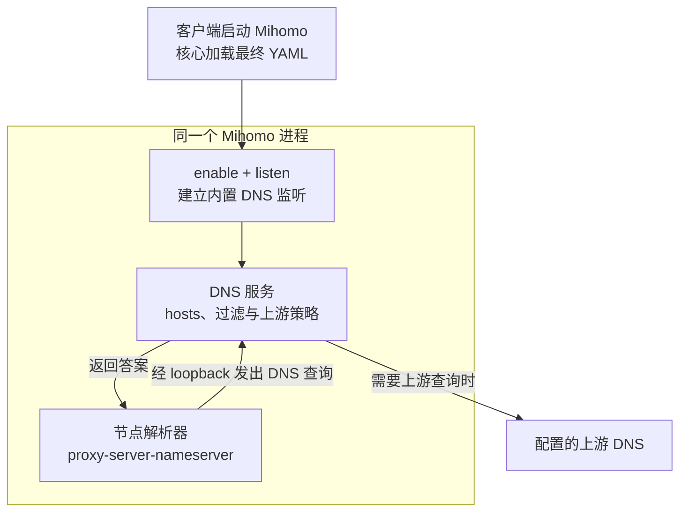
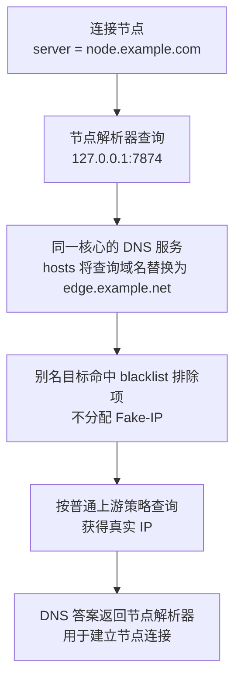

# DNS 流程与 YAML 示例

记录 2026-10-17 讨论中的结构解释。阶段进度和验证结果以[任务入口](../issue-93-dns-references-and-issue-82-overrides.md)为准；OpenSurge 的支持范围以 [profile 契约](../../../sources/decisions/mihomo-profile-overlay.md#dns-reference-composition-and-binding)为准。
以下 YAML 是说明原生 Mihomo 语义的配置片段，示例域名和节点不能直接用于真实连接，也不构成新的验收证据。

## 谁提供 DNS，谁向 DNS 查询

三个字段在同一份 YAML 中承担不同职责：

| 字段 | 含义 |
| --- | --- |
| `dns.listen` | Mihomo 内置 DNS 服务在哪里接收查询 |
| `dns.proxy-server-nameserver` | 解析代理节点域名时，向谁查询 |
| `dns.nameserver` | 普通解析策略需要上游查询时，使用哪些 DNS 服务器 |

客户端启动 Mihomo，核心加载最终配置；在 `dns.enable: true`、有效 `listen` 和端口绑定成功的前提下，同一个进程提供 UDP/TCP DNS 监听。这个监听不要求开启 TUN 或系统代理。
`udp://127.0.0.1:7874` 只是一个使用 UDP 的查询目标，不会另外启动服务。



`0.0.0.0:7874` 覆盖本机 IPv4 地址，包含 loopback，因此本机的 `127.0.0.1:7874` 可以访问该监听。
Mihomo 可以在一个进程中同时作为 DNS 客户端和服务端；提供本机入口并不意味着它不再需要上游 DNS。

## 自身引用：hosts 别名与真实地址

Mihomo 不要求节点解析必须经过自己的监听。可以直接指定外部 DNS，也可以省略 `proxy-server-nameserver`，沿用普通解析策略。
[Issue #93](https://github.com/YTwsy/OpenSurge-for-Mac/issues/93) 报告的是远程订阅原始快照中存在的特定组合，不据此推断这种写法普遍存在。

```yaml
hosts:
  node.example.com: edge.example.net

dns:
  enable: true
  listen: '0.0.0.0:7874'       # 本核心提供的 DNS 服务
  use-hosts: true

  enhanced-mode: fake-ip
  fake-ip-range: 198.18.0.1/16
  fake-ip-filter-mode: blacklist
  fake-ip-filter:
    - edge.example.net       # 别名目标返回真实地址

  nameserver:                # 本机 DNS 服务继续查询的上游
    - 223.5.5.5
    - 119.29.29.29
  respect-rules: false       # 示例的上游查询不经过代理路由规则

  proxy-server-nameserver:
    - udp://127.0.0.1:7874   # 节点解析回到本核心的 DNS 入口

proxies:
  - name: 示例节点
    type: socks5
    server: node.example.com
    port: 1080
```

以未命中可用缓存的查询说明上述组合：



这是把节点查询送入 DNS 服务入口、使用其别名与过滤处理的一种配置方式；订阅作者的具体设计动机仍属推断。
本机地址本身不意味着必有 hosts 或 Fake-IP 排除项。若进入 Fake-IP DNS 服务，需要确保节点获得可连接的真实地址；`redir-host` 模式不需要为此配置 Fake-IP 排除。
本例显式使用 `blacklist`，不能把同一过滤项在 `whitelist` 或 `rule` 模式下当作相同含义。

## OpenSurge 导入前后的关系

普通业务入口沿用现有结构：下游设备经 dnsmasq 转到 Mihomo 受管 `1053`；Mac 经 TUN 捕获的 DNS 请求进入 Mihomo 解析策略。
本任务补齐的是受支持的节点自身引用与运行端点的对应关系：

| 状态 | 任务创建时的行为 | 兼容方案中的绑定 |
| --- | --- | --- |
| 正式网关 | 核心监听 `1053`，节点引用可能仍指向原 `7874` | 已确认的自身引用指向 `127.0.0.1:1053` |
| 准备态有自身依赖 | 保留解析策略，但不监听 DNS，原引用可能落空 | 同一准备态核心按需监听私有 loopback 端口，并绑定引用 |
| 准备态无自身依赖 | 不监听 DNS | 继续不监听 DNS |
| 独立本地或外部 DNS | 按原目标查询 | 保留目标和协议参数，校验资源冲突 |

原始订阅快照保持不变，转换发生在最终运行配置；准备态私有端口不写入长期 desired 配置。
准备态退出后由正式核心接管，DNS 服务的实际就绪与清理均需验证；表中的结构关系不替代任务中的网络验收。
默认自身引用兼容独立于“高级自定义解析”开关。

## 独立本地 DNS：保留外部依赖

假设用户另行运行了一个 DNS 服务，监听 `127.0.0.1:6053`：

```yaml
dns:
  enable: true
  listen: '0.0.0.0:7874'
  proxy-server-nameserver:
    - udp://127.0.0.1:6053   # 用户另行管理的 DNS 服务
```

此时节点查询依赖的是独立服务。OpenSurge 改变自身监听时，应继续保留 `6053`，也不因为这个引用而在准备态启动自身 DNS。
独立服务的启动与停止不属于本任务的管理范围；服务不可用时不能静默换成自身或公共 DNS。

本任务要求结合原 DNS enable/listen、最终目标和用途判断，不以当前端口占用者决定配置含义。
无法确定时报告具体歧义，并允许绑定到来源和引用的“自身服务 / 独立服务”声明；格式和限制见 profile 契约。
独立服务与受管端口冲突仍需报错。未知外部转发循环也不能仅凭地址排除。
验收中“不借另一客户端回答”针对自身兼容；用户明确指定独立服务时，依赖该服务是预期行为。

## 参考

- [Mihomo DNS 配置](https://wiki.metacubex.one/config/dns/)与 [hosts 语义](https://wiki.metacubex.one/config/dns/hosts/)。
- 对照 v1.19.32：[配置应用与 DNS 初始化](https://github.com/MetaCubeX/mihomo/blob/v1.19.32/hub/executor/executor.go#L225)、[UDP/TCP 监听](https://github.com/MetaCubeX/mihomo/blob/v1.19.32/dns/server.go#L97)、[hosts 与 Fake-IP 处理顺序](https://github.com/MetaCubeX/mihomo/blob/v1.19.32/dns/middleware.go#L21)。这些源码解释不替代 OpenSurge 所用补丁核心的验证。
