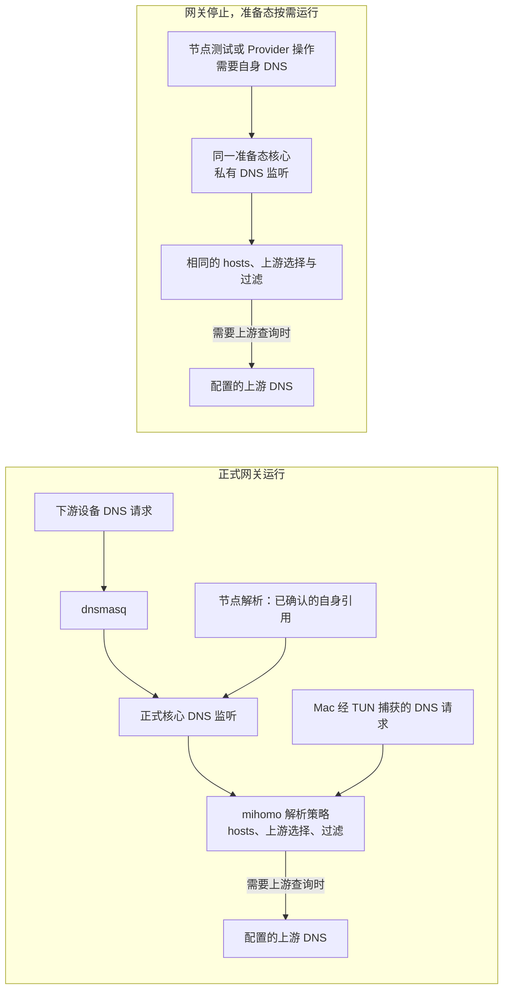

# DNS 接入、服务引用与准备态

OpenSurge 为使用网关 DNS 的下游设备提供 dnsmasq 入口，默认转交 mihomo；
Mac 本机通过系统 DNS 协同与 TUN 捕获接入 mihomo。节点自身 DNS 引用则绑定到当前核心。

下图对照正式网关与准备态的入口；箭头表示请求流向，省略响应回程。

OpenSurge 为已确认的自身 DNS 引用绑定正式或准备态端点，独立解析器保持自己的目标。
准备态只在有此依赖时开启私有监听，不接管系统 DNS 或下游流量；两种状态沿现有生命周期
交接。默认兼容不依赖可选的高级自定义解析开关。

可选外部 DNS 服务负责先给出 DNS 检查结果，OpenSurge 随后才进入既有 hosts / Fake-IP /
解析策略；正常外部真实地址不会替代 Fake-IP，后续设备策略仍由 mihomo 执行。
这一依赖共用于受管服务入口，完整边界见
[外部 DNS 过滤契约](../../sources/decisions/mihomo-profile-overlay.md#external-dns-filtering-before-fake-ip)。

系统 DNS 协同负责 OpenSurge 对本机设置的临时接管与恢复。AAAA 答案、Mac 本机 IPv6
路由与下游 IPv6 接管在本项目中分别管理。

- 查询系统 DNS 所有权、私有解析和 host TUN 路由 → [DNS 契约](../../sources/decisions/local-system-dns-coordination.md)。
- 查询 dnsmasq 与代理引擎的服务职责 → [网关生命周期](../../sources/decisions/gateway-lifecycle.md)。
- 查询自身引用识别、端点绑定、准备态及限制 → [DNS 引用契约](../../sources/decisions/mihomo-profile-overlay.md#dns-reference-composition-and-binding)。
- 查询导入 DNS 字段的保留与受管边界 → [profile overlay 契约](../../sources/decisions/mihomo-profile-overlay.md#imported-dns-policy)。
- 查询本机来源身份与下游隔离 → [本机路由契约](../../sources/decisions/local-mac-routing-modes.md)。
- 查询系统解析、重启与恢复证据要求 → [本机模式门槛](../../sources/validation/test-gates.md#Mac-本机模式隔离门槛)。
- 查询上述路径实际验证到哪里 → [DNS 证据入口](../../sources/validation/evidence-map.md#订阅自身-dns-与准备态)。
