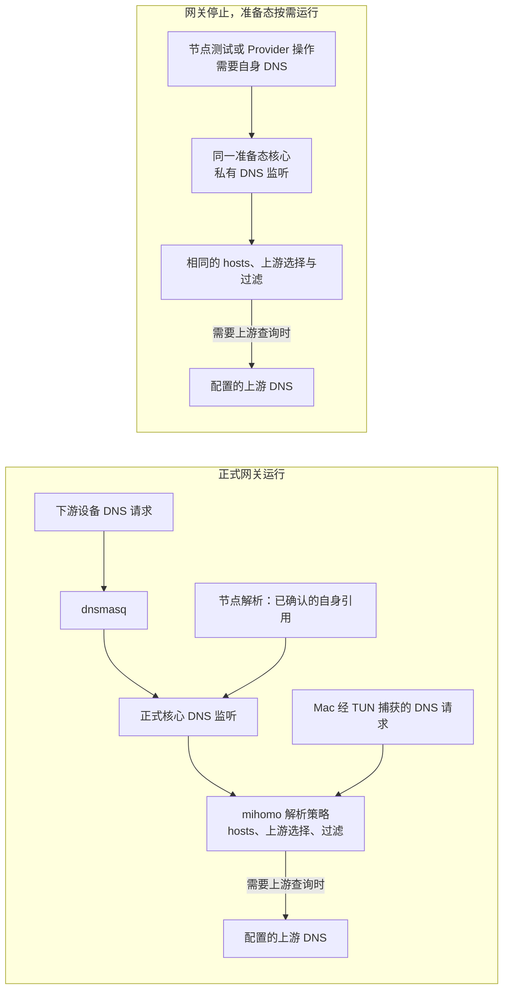

# 系统 DNS、网关解析与 fake IP

OpenSurge 协调两类解析入口：macOS 系统 DNS 面向 Mac 应用，dnsmasq 为使用网关 DNS
的下游设备提供入口。mihomo DNS 承担代理侧的解析策略与域名映射；默认配置将 dnsmasq
的上游连接到它，本机解析则通过系统 DNS 协同与 TUN 捕获接入。

运行时，普通业务查询与节点自身 DNS 引用通过不同入口使用解析策略。下图的箭头表示
请求流向，省略响应回程；hosts、缓存或 fake IP 可以直接给出答案，并非每次都会访问上游。

“自身引用”表达对当前核心 DNS 服务的依赖，运行端点随正式态或准备态绑定；独立解析器
保持自己的目标。准备态只在有此依赖时开启私有监听，不接管系统 DNS 或下游流量。
两种状态沿现有生命周期交接，端点变化不要求开启可选的高级自定义解析。

fake IP 是域名在代理数据面中的虚拟目的地址。引擎维护域名与虚拟地址的对应关系，
使后续连接仍能关联域名并参与策略判断。实际出站所需的解析由相应解析策略与出口负责。
DNS 查询和后续业务连接是不同的流量，fake IP 映射需要与 TUN 等接入路径配合；
取得 DNS 答案、连接进入引擎、实际出口可用分别需要对应证据。
fake IP 表达目标域名，客户端来源身份决定本机或下游设备的策略作用域。

系统 DNS 协同具有临时所有权与恢复边界；局域网私有名称和应用自己的解析通道也有各自
的处理范围。AAAA 答案、Mac 本机 IPv6 路由与下游 IPv6 接管仍是三个不同问题。

- 查询系统 DNS 所有权、私有解析和 host TUN 路由 → [DNS 契约](../../sources/decisions/local-system-dns-coordination.md)。
- 查询 dnsmasq 与代理引擎的服务职责 → [网关生命周期](../../sources/decisions/gateway-lifecycle.md)。
- 查询自身引用识别、端点绑定、准备态及限制 → [DNS 引用契约](../../sources/decisions/mihomo-profile-overlay.md#dns-reference-composition-and-binding)。
- 查询解析策略、fake IP 过滤与映射持久化 → [profile overlay 契约](../../sources/decisions/mihomo-profile-overlay.md#imported-dns-policy)。
- 查询本机来源身份与下游隔离 → [本机路由契约](../../sources/decisions/local-mac-routing-modes.md)。
- 查询系统解析、重启与恢复证据要求 → [本机模式门槛](../../sources/validation/test-gates.md#Mac-本机模式隔离门槛)。
- 查询上述路径实际验证到哪里 → [DNS 证据入口](../../sources/validation/evidence-map.md#订阅自身-dns-与准备态)。
